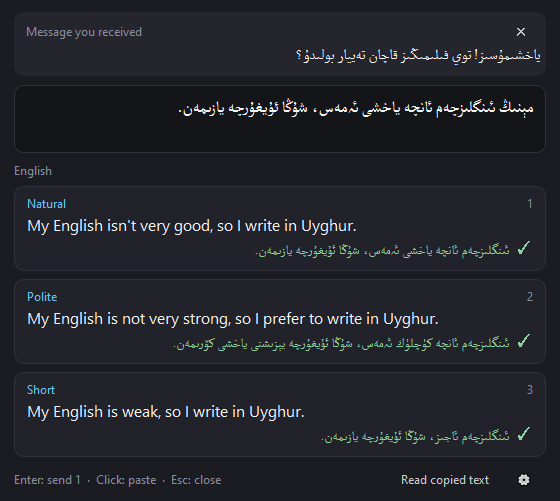
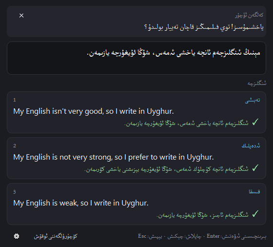

# Terjiman

**Write in Uyghur, send in English.**

ئۇيغۇرچە يېزىڭ، ئىنگلىزچە ئەۋەتىڭ. تەرجىمان ھەر قانداق پروگراممىدا ئىشلەيدۇ: Ctrl+Shift+Space نى بېسىڭ، ئۇيغۇرچە
يېزىڭ، Claude ئۈچ خىل ئىنگلىزچە جۈملە بېرىدۇ، ھەر بىرىنىڭ ئاستىدا ئۇيغۇرچە مەنىسى بار. بىرىنى چېكىڭ ياكى Enter نى بېسىڭ.

Terjiman (تەرجىمان, "translator") is a small helper for Windows. Press **Ctrl+Shift+Space** in any program
(WhatsApp, email, Instagram, YouTube, Claude) and a small box opens. Write your message in Uyghur, and Claude
gives you three English versions:

- **Natural**: how a native speaker would write it
- **Polite**: for clients and people you don't know well
- **Short**: the shortest clear way to say it

Under each version you see its meaning back in Uyghur, so you can check that it says what you mean.

- **Click a version** and it is pasted into the program you came from.
- **Press Enter** and the first version is pasted and sent.
- **Write English instead**, and Terjiman corrects it and explains the mistakes in Uyghur.
- **Got an English message?** Select it and press **Ctrl+C twice**. Terjiman shows it in Uyghur, and the reply
  you write next is translated to fit it.

The app speaks English, Uyghur, Turkish, Arabic and Dutch. In Settings you can also translate into Dutch,
Turkish or Arabic instead of English, or check your meaning in another language than Uyghur.

| English | Uyghur |
|---|---|
|  |  |

The icon is the sky blue of the Kök Bayraq (#0099FF), like T-Player, with a white speech bubble and the letter ت.

## Install

You need Windows 10 or 11, [Python 3.12](https://www.python.org/downloads/) and
[Git](https://git-scm.com/download/win).

1. Get Terjiman with Git, so the update button can update it later:

   ```
   git clone https://github.com/TahirjanAnwar/terjiman.git Terjiman
   ```

2. Double-click **`setup.cmd`** in the `Terjiman` folder. It installs Qt for Python and the Claude SDK into
   `.venv` (about 150 MB), builds `Terjiman.exe`, puts Terjiman on the desktop and in the Start menu, and starts it.

Terjiman lives next to the clock (the blue speech bubble). Click it, or press the shortcut, to open the box.
To have it ready after every restart, tick **Start Terjiman when Windows starts** in Settings.

## Your Claude API key

Terjiman uses Claude through the Anthropic API. It doesn't come with a key: everyone uses their own. The API is
paid per use, separately from a Claude.ai subscription.

1. Sign in at [platform.claude.com](https://platform.claude.com) and add some credit (Settings → Billing).
   $5 is plenty to start.
2. Create a key at [platform.claude.com/settings/keys](https://platform.claude.com/settings/keys).
3. In Terjiman, click **⚙** (Settings), paste the key, click **Check key**, then **Save**.

The key is kept in Windows Credential Manager on your own PC, not in a file, and is only ever sent to Anthropic.

**Cost.** *Best* (Claude Opus 5.5) costs about 1–1.5 US cents per message. *Fast and cheap* (Claude Haiku 5.5)
costs less than 0.1 cent per message, but its Uyghur is weaker. Terjiman asks Claude again each time you pause
while typing. Claude keeps Terjiman's instructions cached for 5 minutes, so those repeats cost about 30% less.

**Privacy.** What you write in the box, and the text you read with Ctrl+C twice, is sent to Anthropic's API to be
translated. Nothing else leaves your PC.

## Keys

| Key | What it does |
|---|---|
| Ctrl+Shift+Space | Open or close the box (change it in Settings) |
| Enter | Paste the first version and send it |
| Shift+Enter | New line |
| Click, or Ctrl+1 / 2 / 3 | Paste that version without sending |
| Esc | Close the box |
| Ctrl+C twice | Show the selected text in your language |

If Terjiman can't paste into the other program, the text stays copied: press Ctrl+V there.

## Updates

Click **Check for updates** in Settings or in the tray menu. Terjiman downloads the new version from GitHub
(`git pull`), installs new packages if needed, and restarts. It also checks quietly a few seconds after it starts.

## For developers

- `terjiman.py`: the box, tray icon, settings, pasting and updates (Qt for Python, PySide6)
- `engine.py`: the prompts and the streamed Claude requests (structured JSON output, refusal fallback on Opus)
- `winkeys.py`: the system-wide shortcut and the keystrokes into other programs (Win32 through ctypes)
- `locales/*.json`: the app's texts in five languages

Checks (they cost nothing: the app checks use canned demo answers, the engine check uses a fake key):

```
.venv\Scripts\python.exe tools\check_engine.py
.venv\Scripts\python.exe tools\check_settings.py
.venv\Scripts\python.exe tools\check_app.py
```

`check_app.py` drives real windows (a test copy of Terjiman and Notepad) with real keystrokes. It waits until the
keyboard and mouse are idle and stops if another window comes to the front. `terjiman.py --screenshot DIR` makes
pictures of the box and the settings window in every language. `tools\make_icon.py` draws the icon.
