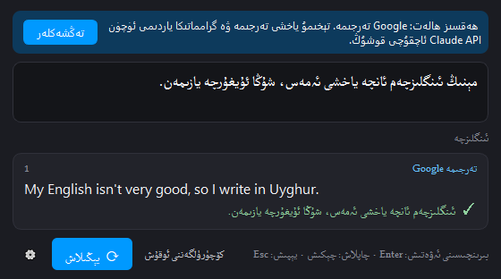

# Terjiman

**Write in Uyghur, send in English.**

ئۇيغۇرچە يېزىڭ، ئىنگلىزچە ئەۋەتىڭ. تەرجىمان ھەر قانداق پروگراممىدا ئىشلەيدۇ: Ctrl+Shift+Space نى بېسىڭ، ئۇيغۇرچە
يېزىڭ، Claude ئۈچ خىل ئىنگلىزچە جۈملە بېرىدۇ، ھەر بىرىنىڭ ئاستىدا ئۇيغۇرچە مەنىسى بار. بىرىنى چېكىڭ ياكى Enter نى بېسىڭ.
ئاچقۇچىڭىز بولمىسا، تەرجىمان Google ئارقىلىق ھەقسىز ئىشلەيدۇ.

Terjiman (تەرجىمان, "translator") is a small helper for Windows and Mac. Press **Ctrl+Shift+Space** (on a Mac
**⌘+Shift+Space**) in any program
(WhatsApp, email, Instagram, YouTube, Claude) and a small box opens. Write your message in Uyghur, and Claude
gives you three English versions:

- **Natural**: how a native speaker would write it
- **Polite**: for clients and people you don't know well
- **Short**: the shortest clear way to say it

Under each version you see its meaning back in Uyghur, so you can check that it says what you mean.

- **Click a version** and it is pasted into the program you came from.
- **Press Enter** and the first version is pasted and sent.
- **Write English instead**, and Terjiman corrects it and explains the mistakes in Uyghur.
- **Got an English message?** Select it and press **Ctrl+C twice**. Terjiman shows it in Uyghur, and the reply
  you write next is translated to fit it.

**No key? It still works, for free.** Without a Claude API key, Terjiman uses Google Translate: one plain
translation (no styles and no grammar help), with its meaning in Uyghur underneath. Google makes more mistakes,
and that meaning line is how you catch them. Add a Claude key whenever you want the better translations.

The app speaks English, Uyghur, Turkish, Arabic and Dutch. In Settings you can also translate into Dutch,
Turkish or Arabic instead of English, or check your meaning in another language than Uyghur.

| English | Uyghur |
|---|---|
|  |  |

The icon is the sky blue of the Kök Bayraq (#0099FF), like T-Player, with a white speech bubble and the letter ت.

## Download

Get it from the **[Releases page](https://github.com/TahirjanAnwar/terjiman/releases/latest)**. Nothing else is
needed: no Python, no Git.

| Computer | File | Works on |
|---|---|---|
| Windows | `Terjiman.exe` | Windows 10 and 11 |
| Mac with Apple Silicon (M1, M2, M3, M4…) | `Terjiman-mac-AppleSilicon.dmg` | macOS 11 Big Sur and newer |
| Mac with Intel | `Terjiman-mac-Intel.dmg` | macOS 10.15 Catalina and newer |

### On Windows

Put `Terjiman.exe` where you like (Documents, for example) and double-click it. The first time, Windows may say
**"Windows protected your PC"**: click **More info**, then **Run anyway**. Windows says this about programs that
aren't signed with a paid certificate.

Terjiman lives next to the clock (the blue speech bubble). Click it, or press **Ctrl+Shift+Space** in any program,
to open the box. To have it ready after every restart, tick **Start Terjiman when Windows starts** in Settings.

### On a Mac

1. Open the `.dmg` and drag **Terjiman** onto **Applications**.
2. The first time, macOS says it can't check the app, because Terjiman isn't signed with a paid Apple account:
   - macOS 10.15 to 14: in Applications, right-click (or Control-click) **Terjiman**, choose **Open**, then **Open**.
   - macOS 15 and newer: open Terjiman once, then go to **System Settings → Privacy & Security** and click
     **Open Anyway**.
3. Terjiman lives in the menu bar at the top (the blue speech bubble). Press **⌘+Shift+Space** in any app.
4. The first time you paste, macOS asks you to allow Terjiman under **Privacy & Security → Accessibility**.
   Switch it on: from then on Terjiman can paste for you. Without it, Terjiman copies the text and you press ⌘V.

On a Mac the keys use ⌘ where Windows uses Ctrl: ⌘+Shift+Space opens the box, ⌘+C twice reads a copied message,
⌘+1 / 2 / 3 pastes a version.

### From GitHub with Python (Windows)

For a copy you can change: you need [Python 3.12](https://www.python.org/downloads/) and
[Git](https://git-scm.com/download/win).

1. `git clone https://github.com/TahirjanAnwar/terjiman.git Terjiman`
2. Double-click **`setup.cmd`** in the `Terjiman` folder. It installs Qt for Python and the Claude SDK into
   `.venv` (about 150 MB), builds a small `Terjiman.exe` starter, puts Terjiman on the desktop and in the Start
   menu, and starts it.

## Free, or better with your own Claude key

| | Free: Google Translate | Claude Haiku 5.5 | Claude Opus 5.5 (best) |
|---|---|---|---|
| Key needed | No | Yes | Yes |
| Versions | 1 | 3 (natural, polite, short) | 3 (natural, polite, short) |
| Grammar help for English | No | Yes | Yes |
| Uyghur quality | Weakest | Good English, weaker Uyghur | Best |
| Cost | Free | Less than 0.1 cent a message | About 1–1.5 US cents a message |



Without a key Terjiman starts in free mode, and a blue line in the box says so. To choose Google on purpose, pick
**Free: Google Translate** in Settings. The free mode uses Google Translate's free web service: it isn't an
official API, so Google can limit very heavy use or change it.

For Claude, Terjiman uses the Anthropic API. It doesn't come with a key: everyone uses their own. The API is
paid per use, separately from a Claude.ai subscription.

1. Sign in at [platform.claude.com](https://platform.claude.com) and add some credit (Settings → Billing).
   $5 is plenty to start.
2. Create a key at [platform.claude.com/settings/keys](https://platform.claude.com/settings/keys).
3. In Terjiman, click **⚙** (Settings), paste the key, click **Check key**, then **Save**.

The key is kept on your own computer (Windows Credential Manager, or the macOS Keychain), not in a file, and is
only ever sent to Anthropic. Terjiman's settings are in `%APPDATA%\Terjiman` on Windows and in
`~/Library/Application Support/Terjiman` on a Mac (a GitHub copy keeps them in its own folder).

**Cost.** *Best* (Claude Opus 5.5) costs about 1–1.5 US cents per message. *Fast and cheap* (Claude Haiku 5.5)
costs less than 0.1 cent per message, but its Uyghur is weaker. Terjiman asks Claude again each time you pause
while typing. Claude keeps Terjiman's instructions cached for 5 minutes, so those repeats cost about 30% less.

**Privacy.** What you write in the box, and the text you read with Ctrl+C twice, is sent to be translated: to
Anthropic's API with Claude, or to Google in free mode. Nothing else leaves your PC.

## Keys

| Key | What it does |
|---|---|
| Ctrl+Shift+Space | Open or close the box (change it in Settings) |
| Enter | Paste the first version and send it |
| Shift+Enter | New line |
| Click, or Ctrl+1 / 2 / 3 | Paste that version without sending |
| Esc | Close the box |
| Ctrl+C twice | Show the selected text in your language |

If Terjiman can't paste into the other program, the text stays copied: press Ctrl+V there.
On a Mac, read ⌘ for Ctrl in this table.

## Updates

The **⟳** button at the bottom of the box checks GitHub for a new version. Terjiman also checks by itself a few
seconds after it starts and every 6 hours. When there is an update, the button turns blue and says **Update**.
Click it:
- `Terjiman.exe` downloads the new `Terjiman.exe`, puts it in place of the old one and restarts.
- On a Mac, the download page opens: download the new `.dmg` and drag Terjiman onto Applications again.
- A GitHub copy runs `git pull`, installs new packages if needed, and restarts. If a newer version is already on
  your PC (for example after `git pull`), the button says **Restart**.

*Check for updates* is in Settings and in the tray (menu bar) menu too.

## For developers

- `terjiman.py`: the box, tray icon, settings, pasting and updates (Qt for Python, PySide6)
- `engine.py`: the prompts and the streamed Claude requests (structured JSON output, refusal fallback on Opus,
  cached instructions), and the free Google Translate engine
- `winkeys.py`: the system-wide shortcut and the keystrokes into other programs on Windows (Win32 through ctypes)
- `mackeys.py`: the same on macOS (a Carbon hot key, Quartz keystrokes, AppKit; needs pyobjc)
- `locales/*.json`: the app's texts in five languages
- `terjiman.spec`: the PyInstaller recipe for `Terjiman.exe` and `Terjiman.app`; `tools/build_mac.sh` makes the
  `.dmg` (Qt 6.4 and Python 3.11 from python.org, for macOS 10.15), `tools/mac_min_version.py` checks that no file
  in the app needs a newer macOS
- `.github/workflows/build.yml`: pushing a tag `vX.Y.Z` builds all three downloads into a draft release

Checks (they cost nothing: canned demo answers, free Google Translate, and a fake key that Anthropic refuses):

```
.venv\Scripts\python.exe tools\check_engine.py
.venv\Scripts\python.exe tools\check_settings.py
.venv\Scripts\python.exe tools\check_app.py [--exe dist\Terjiman.exe]
.venv\Scripts\python.exe tools\check_frozen.py dist\Terjiman.exe
```

On a Mac, `tools/check_mac.py` checks the shortcut, the Accessibility check and HTTPS.

`check_app.py` drives real windows (a test copy of Terjiman and Notepad) with real keystrokes. It waits until the
keyboard and mouse are idle and stops if another window comes to the front. `terjiman.py --screenshot DIR` makes
pictures of the box and the settings window in every language. `tools\make_icon.py` draws the icon.

## License

Terjiman's own code is under the [MIT License](LICENSE). You may use, change and share it, as long as you keep
the copyright notice. The packages that `setup.cmd` installs keep their own licenses: Qt for Python (LGPL), the
Anthropic SDK (Apache 2.0), and keyring and jiter (MIT).
